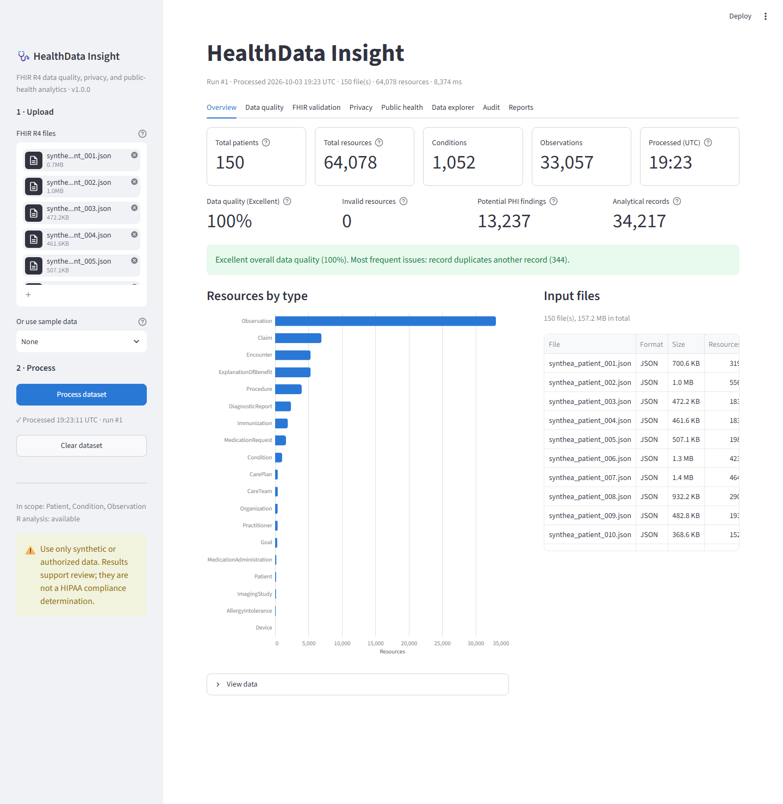
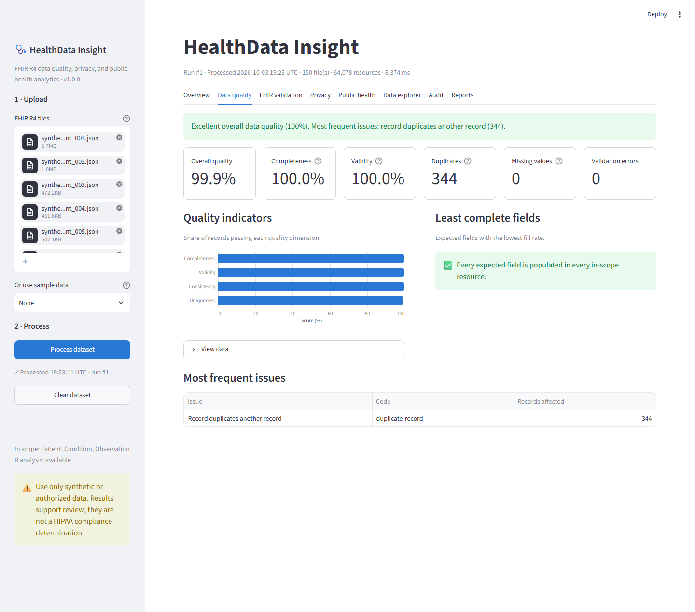
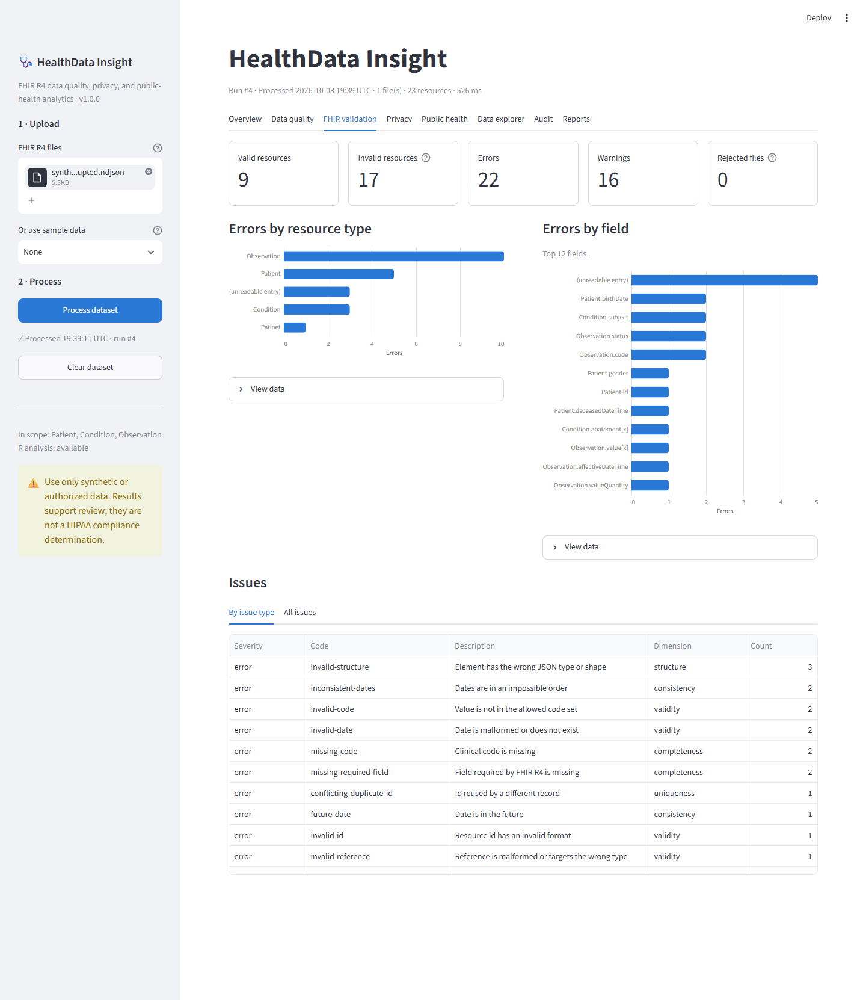
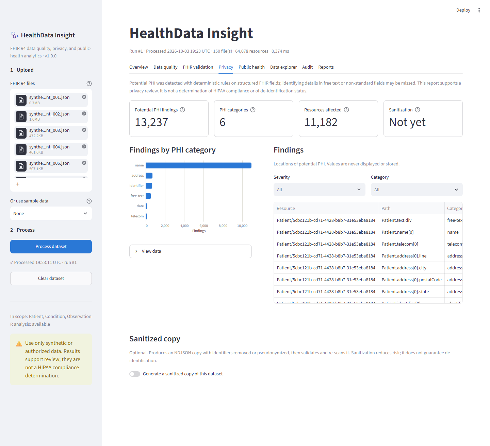
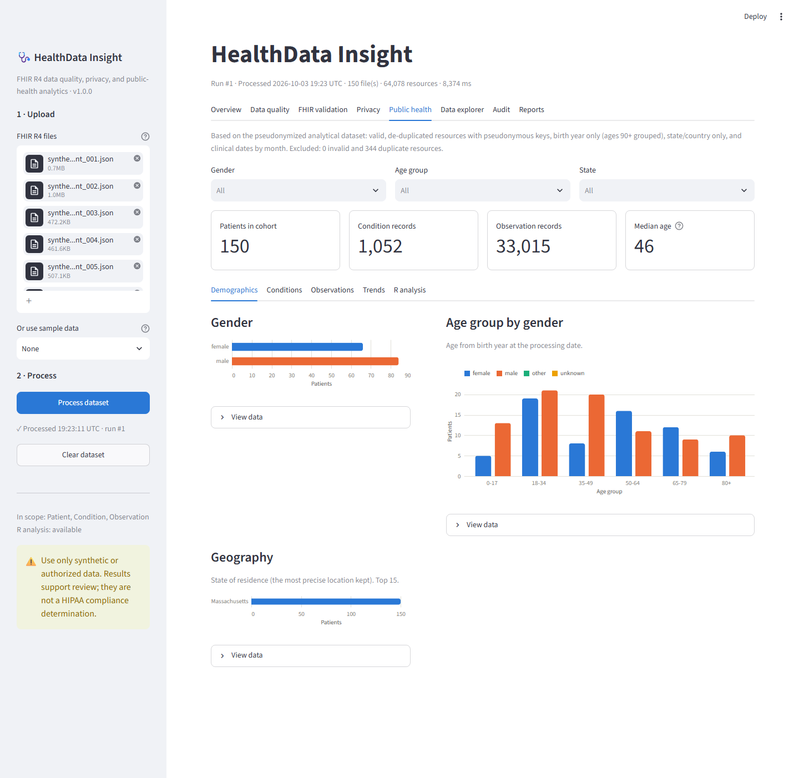
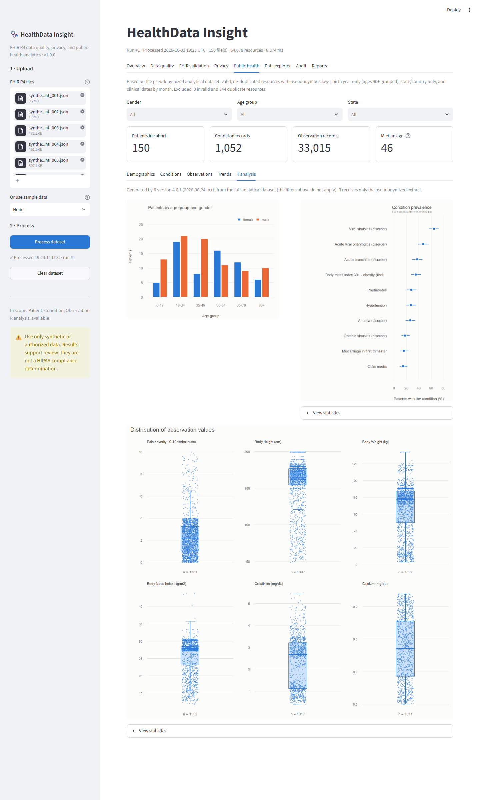
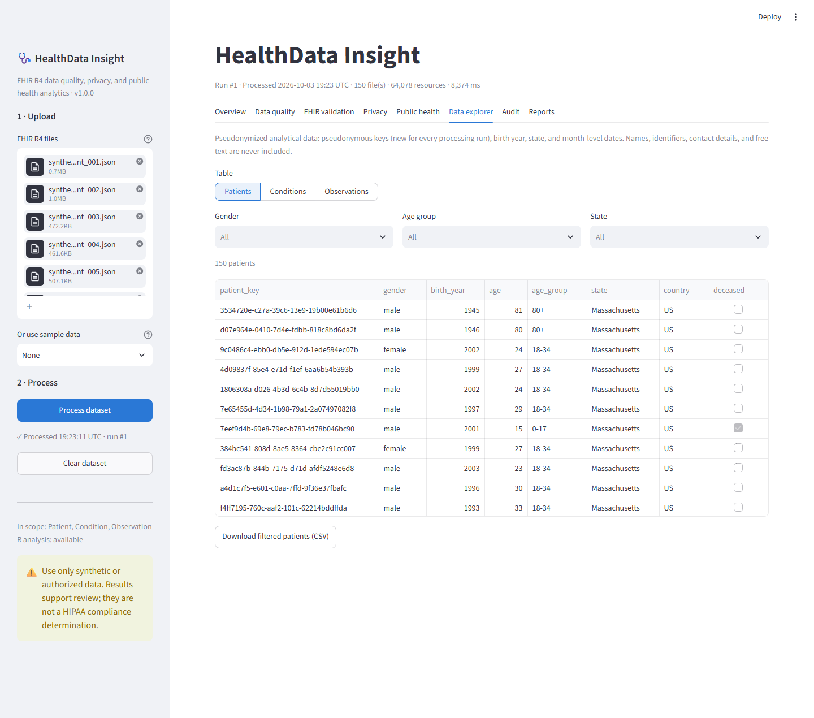
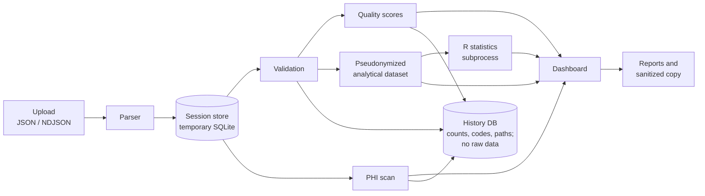

# HealthData Insight

### A FHIR R4 Healthcare Data Quality, Privacy, and Public Health Analytics Platform


HealthData Insight checks FHIR R4 healthcare data **before** it is used for public-health analysis. It:
- **validates** the FHIR structure;
- **measures data quality** (completeness, validity, consistency, uniqueness);
- **finds potential PHI** in structured fields;
- can produce a **sanitized copy**, which it then re-validates;
- reports **public-health statistics** from a pseudonymized analytical view, including R-generated confidence
  intervals.

> **Synthetic data only. Research prototype.** Built and evaluated exclusively on synthetic patients generated by
> [Synthea](https://synthetichealth.github.io/synthea/).
> - It is **not** HIPAA compliant, **not** clinically validated, **not** endorsed by the CDC or any public-health
>   agency, and **not** production-ready.
> - Its PHI detection and sanitization **reduce** privacy risk but **do not guarantee de-identification**. The
>   evaluation documents specific blind spots (free text, address geolocation, provider addresses).



---

## At a glance

| | |
| --- | --- |
| **Evaluated on** | 1,180 synthetic patients, 527,113 FHIR R4 resources (Synthea 1K sample) |
| **Validation** | 3,000 of 3,000 injected defects detected; 0 false "invalid" flags |
| **PHI detection** | 94.0% precision, 96.9% recall overall. **0% recall on free text** |
| **Information kept after pseudonymization** | Identical prevalence, statistics, and monthly trends; 98.98% age-group agreement |
| **Speed** | About 5,600 resources per second; all 1,180 patients in 93 seconds |
| **Read more** | [Technical report (PDF, 3 pages)](docs/technical-report.pdf) · [Full evaluation](EVALUATION.md) |

## The problem

Public-health programs increasingly receive clinical data as **HL7 FHIR R4**: EHR bulk exports, case reports, and
data feeds. Before such data can support surveillance or analysis, three questions must be answered:

1. **Is it valid FHIR?** Are structures, codes, dates, and references correct?
2. **Is it fit for analysis?** Is it complete, internally consistent, and free of duplicates?
3. **Is it safe to analyze or share?** Where are the identifiers, and what remains after they are removed?

These checks are often manual, scattered across tools, or skipped. HealthData Insight answers all three in one
reproducible workflow, and every result can be traced and downloaded.

## Public-health relevance

- **Data quality before statistics.** Prevalence, demographics, and trends inherit every error in the records
  behind them. Analytics run only on records that passed validation and de-duplication, and the excluded counts are
  reported.
- **Data minimization by design.** Public-health use of clinical data depends on using no more identifiable data
  than necessary. Analytics read only a pseudonymized, allow-listed extract: pseudonymous keys, birth year, state,
  and month-level dates. R never sees raw records.
- **Measured privacy, not assumed privacy.** Every sanitized copy is re-validated and re-scanned. The evaluation
  quantifies what the privacy controls miss, not only what they catch.
- **Audit and reproducibility.** Every processing run is logged without raw data. The evaluation reproduces with
  one command against a checksum-verified public dataset.

## Key features

| Area | What it does |
| --- | --- |
| **Ingestion** | JSON (resource, array, Bundle) and NDJSON; malformed entries recorded line by line; hostile input (deep nesting, oversized files) rejected cleanly |
| **FHIR validation** | All 146 R4 resource types recognized; Patient, Condition, and Observation checked for structure, required fields, code sets, real calendar dates, date order, and resolvable references |
| **Data quality** | Completeness, validity, consistency, and uniqueness scores; overall grade; most frequent issues; field-level completeness |
| **Duplicates** | Repeated ids (identical or conflicting), identical content under new ids, Patients sharing an identifier |
| **Privacy** | Rule-based PHI detection in structured fields (locations only; values are never shown or stored); configurable sanitization with keyed pseudonyms and preserved references; output re-validated and re-scanned |
| **Public health** | Demographics, condition prevalence, observation statistics, temporal trends; R charts with exact 95% confidence intervals |
| **Data explorer** | Filter and export the pseudonymized analytical tables |
| **Audit and reports** | Run history without PHI; JSON/CSV reports and a ZIP bundle; CSV formula injection neutralized |

## Screenshots

| | |
| --- | --- |
|  **Data quality.** Scores, indicators, field completeness |  **FHIR validation.** Errors by resource type and field (built-in corrupted sample) |
|  **Privacy.** PHI findings by category and location (never values) |  **Public health.** Demographics with cohort filters |
|  **R analysis.** Prevalence with exact 95% CIs; value distributions |  **Data explorer.** Pseudonymized records only |

Screenshots show 150 Synthea patients (files renamed to neutral names), except FHIR validation, which uses the
built-in corrupted sample. The audit view is in [`docs/screenshots/08-audit.png`](docs/screenshots/08-audit.png).

## Architecture



- **Streamlit UI** (`app.py`, `src/healthdata_insight/ui/`) over a **Streamlit-independent Python package**. The
  whole pipeline runs and is tested headlessly.
- **One issue model.** Every finding is a coded issue with a severity and a quality dimension. Scores, tables,
  reports, and the history database all derive from it.
- **Two SQLite databases.** A per-session temporary store holds raw uploads and is deleted at session end. A
  persistent history database never holds resource content, field values, or file names.
- **R isolation.** R runs as a subprocess (`Rscript --vanilla`, no shell) on pseudonymized CSV extracts only.

Details: [ARCHITECTURE.md](ARCHITECTURE.md)

**Technologies:** Python 3.11+ · Streamlit · pandas · Altair · SQLite · R (base R, optional) · pytest

## Evaluation methodology

Evaluated on Synthea's published **["1K Sample Synthetic Patient Records, FHIR R4"](https://synthetichealth.github.io/synthea-sample-data/downloads/synthea_sample_data_fhir_r4_sep2019.zip)**:
1,180 patients, 527,113 resources, SHA-256 verified. It was processed through the application's own ingestion path
with a fixed seed and reference date.

| Question | Method |
| --- | --- |
| **Validation accuracy** | 15 defect types (200 each) injected into copies of real resources, **one type per pass** so defects can't mask each other; ground truth by construction |
| **Data-quality detection** | 11 completeness and consistency defect types, isolated in the same way; completeness accounting checked exactly |
| **Duplicate detection** | 8 constructed cases, including true negatives (changed values or dates) and a deliberately hard case (same person, new identifiers) |
| **PHI precision and recall** | 302,269 labelled locations. Labels come from a written reference policy modelled on the HIPAA Safe Harbor identifier categories (a yardstick, not a compliance test), applied independently of the detector, **plus planted** free-text PHI and decoys |
| **Sanitization** | Two configurations on all resources: re-validation, reference integrity, remaining findings, and a search for every original identifying value in the output |
| **Information preserved** | Statistics from raw data (exact dates and ages) compared with the pseudonymized analytical dataset |
| **Performance** | Batch mode over all patients; single-process scaling at 50–600 patients (3 repeats); one end-to-end browser run |

## Results

| Measure | Result |
| --- | --- |
| FHIR validation | **3,000 / 3,000** injected defects reported with the expected code; **0** of 7.9 M clean record checks flagged invalid |
| Data-quality defects | **2,200 / 2,200** detected; missing-field accounting exact in 48 / 48 passes |
| Duplicates | Precision **100%**, recall **80%**. The same person re-registered with new identifiers is missed (no fuzzy linkage) |
| PHI detection: overall | Precision **94.0%**, recall **96.9%** |
| PHI detection: structured Patient fields | Precision 92.7%, recall 92.7%. All misses are address latitude/longitude |
| PHI detection: free text (`valueString`, `note`) | Recall **0%**, by design (no NLP) |
| PHI detection: narratives | Recall 100%, precision **16.5%** (every narrative is flagged) |
| Sanitization (default) | **0** high-risk findings left; **0** new validation errors; **0** broken references; all 527,113 resources re-parsed |
| Values remaining after sanitization | **0** names, phones, identifiers, streets, or full birth dates of the patient. The patient's **postal code still appears in provider addresses for 231 patients** |
| Information preserved | Identical prevalence (137 conditions), observation means and SDs (104 series), and monthly trends; **98.98%** age-group agreement |
| Throughput | **5,646 resources/s** end to end (all patients in 93.4 s, batched); about 5,500/s in a single process at 50–600 patients |

The evaluation also found and fixed genuine defects. The two most significant:
- exact birth dates survived sanitization through encounters and observations dated on the day of birth;
- grouping ages 90+ mishandled patients who died young.

All 13 product fixes, and 3 corrections to the evaluation harness itself, are listed in
[EVALUATION.md](EVALUATION.md#issues-found-and-fixed-during-this-evaluation).

## Limitations

- **Synthetic data only.** Synthea data is cleaner than real exports. High detection rates mostly show that the
  rules are implemented correctly, not that they cover real-world error patterns.
- **Not a conformance validator.** There are no profiles, no terminology bindings, and few FHIRPath invariants.
  Only Patient, Condition, and Observation are analyzed in depth.
- **Rule-based PHI detection.**
  - It misses identifying text in free text and fields without a rule.
  - Sanitization keeps other parties' data, such as provider addresses.
  - Neither guarantees de-identification.
- **In-memory processing.** Memory is about 3.7 MB per Synthea patient. The full 1,180-patient dataset wasn't run in
  one process on a 16 GB machine shared with other applications.
- **Single-user and local.** There is no authentication and no encryption at rest.

More: [LIMITATIONS.md](LIMITATIONS.md) · [SECURITY.md](SECURITY.md)

## Reproducibility

**Requirements:** Python 3.11+. R 4.x is optional: with R, the app also shows R charts and statistics; without it,
only the Python charts appear.

```powershell
git clone https://github.com/A-m-anuel/healthdata-insight.git
cd healthdata-insight
python -m venv .venv
.venv\Scripts\activate                       # macOS/Linux: source .venv/bin/activate
pip install -e ".[dev]"
pip install -r requirements-lock.txt         # optional: the exact versions used for the evaluation
```

| Task | Command |
| --- | --- |
| Run the app | `streamlit run app.py`, then pick **Sample data** in the sidebar and click **Process dataset** |
| Run the tests | `pytest` (356 tests, including headless end-to-end dashboard tests) |
| Reproduce the evaluation | `python -m evaluation.run_evaluation` (downloads and verifies the dataset; about 18 minutes; writes `evaluation/results/`) |
| Quick evaluation | `python -m evaluation.run_evaluation --patients 40 --batch-size 20 --perf-sizes 10 --perf-repeats 1` |

- **Deterministic:** accuracy, privacy, sanitization, and information results (fixed seed, reference date, and
  pinned dataset checksum).
- **Machine-dependent:** timings and memory.

| Setting | Default | Purpose |
| --- | --- | --- |
| `HDI_DB_PATH` | `data/healthdata_insight.db` | History database location |
| `HDI_RSCRIPT` | auto-detected | Path to `Rscript` |

## Documentation

| Document | Contents |
| --- | --- |
| [docs/technical-report.pdf](docs/technical-report.pdf) | Three-page technical report: methods, results, discussion |
| [EVALUATION.md](EVALUATION.md) | Full evaluation: methods, all results, fixes, threats to validity |
| [ARCHITECTURE.md](ARCHITECTURE.md) | Data flow, modules, storage design, design decisions |
| [SECURITY.md](SECURITY.md) | Threat model, controls, known gaps |
| [LIMITATIONS.md](LIMITATIONS.md) | Scope, privacy, analytics, and engineering limitations |
| [evaluation/results/results.md](evaluation/results/results.md) | Generated result tables (not hand-edited) |

## Repository layout

```
app.py                       Streamlit entry point
src/healthdata_insight/      Application package (parser, validation, quality, PHI, sanitization, analytics, ...)
  ui/                        Dashboard sections
  r/analytics_plots.R        Base-R statistics and charts
  sample_data/               Built-in synthetic samples (fictional)
evaluation/                  Reproducible evaluation harness and generated results
docs/                        Technical report and screenshots
scripts/generate_samples.py  Regenerates the built-in samples
tests/                       pytest suite
```

## Data and attribution

- **Built-in samples** are fictional records generated by `scripts/generate_samples.py`.
- **Evaluation data** is synthetic output of [Synthea](https://github.com/synthetichealth/synthea), an open-source
  generator from The MITRE Corporation. It is downloaded at evaluation time and not stored in this repository.
- **No real patient data** was used at any stage.

This project is not affiliated with or endorsed by MITRE, HL7, the CDC, or any other organization.
